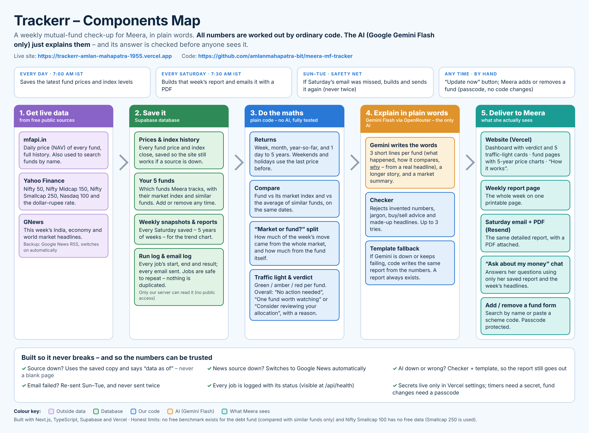
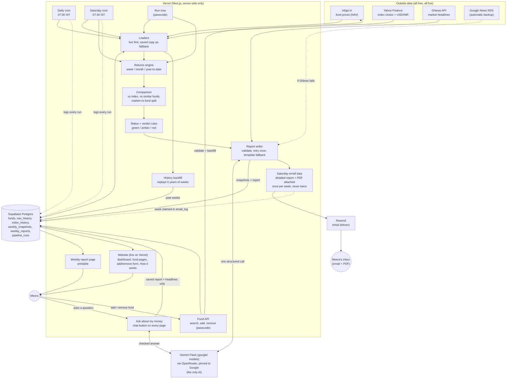

# Components Map

How Trackerr turns raw fund prices into a plain-language Saturday report.
Everything numeric is computed by code; Gemini only explains the numbers.

## The one-page picture (start here)

Left to right: **1. get live data** (mfapi.in, Yahoo Finance, GNews with a Google News backup) &rarr; **2. save it** (Supabase) &rarr; **3. do the maths** (plain, tested code) &rarr; **4. explain in plain words** (Gemini Flash, checked, with a template fallback) &rarr; **5. deliver to Meera** (website, weekly report page, Saturday email with PDF, "Ask about my money" chat, add/remove fund form). Timers run it every day and every Saturday; a safety net re-sends a missed email. Exports for submission: [`components-map.png`](components-map.png) and [`components-map.pdf`](components-map.pdf) (source: [`map/components-map.html`](map/components-map.html)).

The detailed diagram and the component-by-component table below are for readers who want the technical depth.

## Data flow

_This detailed diagram is the technical view; the simple one-page version above is the file to submit._

## Components

Failure behaviour is the important column: the site must never show a blank page.

| Component | Job | Inputs | Outputs | If it fails |
|---|---|---|---|---|
| **mfapi source** `src/lib/sources/mfapi.ts` | Fetch fund price history, search by name, list all schemes | Scheme code or name | Clean price series | 15 s timeout, 2 retries with backoff; loaders use the saved copy in `nav_history` and say so |
| **Index source** `src/lib/sources/indices.ts` | Daily closes for Nifty 50 / Midcap 150 / Smallcap 250 / Nasdaq 100 and USD→INR | Yahoo symbol | Clean close series (days labelled in the market's own time zone) | Same retries; falls back to `index_history`; benchmark marked "not available" and the fund is compared with similar funds instead |
| **News source** `src/lib/sources/news.ts` | Up to 12 relevant headlines (3 topics) of the week | GNews key (optional) | Headlines + which source was used | GNews error / rate limit / no key → **Google News RSS** automatically; if both fail the report says news was unavailable |
| **Loaders** `src/lib/pipeline/load.ts` | Live first, save what was fetched, saved copy as fallback; drops today's unfinished index row | Source results, DB | Series + a plain-language note when a fallback was used | Throws only when there is neither live nor saved data |
| **Returns engine** `src/lib/returns.ts` | Week / month / year-to-date returns; nearest earlier date for weekends and holidays; peer average | Price series | Percentages with the base dates used | Missing or stale base (> 7 days) gives *no number*, never a guess |
| **Comparison** `src/lib/comparison.ts` | Gap vs index and vs similar funds on the fund's own dates; USD→INR + one-day lag for the Nasdaq fund; "market vs fund" split | Fund + index + peers | Gaps, split | Missing index → category only; failed peers skipped and counted ("average of N funds") |
| **Status + verdict** `src/lib/status.ts`, `src/lib/config.ts` | Green/amber/red per fund (month gap + weeks behind in a row); overall verdict (exact 3 strings) | Gaps, last snapshot | Status, verdict, specific reason | Unknown data shows "unknown", not green |
| **Report writer** `src/lib/gemini*.ts`, `report-*.ts` | One structured Gemini call through OpenRouter (Google models only, provider pinned to Google); check the answer; one retry; template fallback | Computed facts only | Three sentences per fund, verdict reason | Busy (429/5xx) → 3 retries with backoff, then the next Flash model; out of credits (402) or unreachable → template; invalid answer → one retry then template. The report always exists and records which writer was used and the cost. |
| **Email step** `src/lib/pipeline/email.ts`, `src/lib/email.ts`, `src/lib/sources/resend.ts` | Builds the detailed Saturday report email (HTML + text, all text escaped, only http(s) links) and sends it through Resend right after the report is saved | The saved report, `RESEND_API_KEY`, `REPORT_EMAIL_TO` | One email per week; a row in `email_log` | Not set up → skipped with a reason; week already sent or being sent → skipped (unique index + Resend idempotency key); log unreadable → nothing sent; Resend error → plain-language reason, recorded, report unaffected, retry allowed |
| **History backfill** `src/lib/pipeline/backfill.ts`, `src/lib/snapshots.ts` | Replays past Saturdays from stored price histories with the same maths as a live week | Fund, similar-fund and index histories | Weekly snapshot rows (numbers only) for up to 5 years | Only writes weeks before the first real report; safe to repeat; a missing index means that fund is compared with similar funds only |
| **Period returns** `src/lib/periods.ts` | 1 day, 1 week, 1 month, 6 months, 1 year, 3 years, 5 years and since the fund started, plus the average per year | A fund's full price history | Percentages with the start date used | A fund too young for a period shows "not enough history", never a guess |
| **Pipeline jobs** `src/lib/pipeline/*` | Daily prices job, weekly report job, "run now" | Active funds | Rows in the database; a log line in `pipeline_runs` | Every run logged with status `success` / `partial` / `failed` and error; double-click guard; all writes are upserts (safe to repeat) |
| **Cron routes** `src/app/api/cron/*` | Entry points for Vercel Cron | `Authorization: Bearer CRON_SECRET` | Job result JSON | Wrong or missing secret → 401, nothing runs |
| **Fund API** `src/app/api/funds/*`, `src/lib/funds-service.ts` | Search (Direct Growth only), preview, add (validate, backfill, find peers), remove (switch off) | Name or scheme code, `ADMIN_PASSCODE` | Fund list changes | Plain-language errors; a half-finished add is rolled back; remove keeps history |
| **Database** Supabase (RLS on, no public policies) | Stores funds, prices, snapshots, reports, run log | Server code with the service-role key | Rows | Unique keys make jobs idempotent; verdict values enforced by a CHECK constraint |
| **Ask about my money** `src/lib/ask.ts`, `src/app/api/ask/route.ts`, `src/components/Ask*.tsx` | A chat button on every page; Gemini answers a plain-words question using only the saved report and the week's real headlines | Question (max 300 letters), latest report | A short plain answer | Answer checked for invented numbers, jargon, advice and made-up headlines (one retry, then a safe "could not answer"); 12 questions/hour per visitor; AI down → friendly "try again" message |
| **PDF report** `src/lib/report-pdf.ts` | Builds the weekly report as a PDF in code (no browser needed) and attaches it to the Saturday email | The saved report | A multi-page A4 PDF | If the PDF cannot be built the email still goes out without it |
| **Weekly report page** `src/app/report` | The whole week on one printable page (also what the email contains) | Latest report | Glance table, why markets moved (clickable sources), per-fund story | Same as the website |
| **Website** `src/app` | Dashboard, add/remove form, "How this works" | Database (server-side) | What Meera sees | Last good report with "data as of"; skeleton while loading; friendly error box |
| **Health endpoint** `src/app/api/health` | Public read-only run log | `pipeline_runs` | Last 10 runs | 503 with a plain message |

## Security model

- The browser never talks to the database. Only server code with the service-role key does (RLS has no public policies).
- Cron routes need `CRON_SECRET`; fund changes and "run now" need `ADMIN_PASSCODE` (constant-time comparison, short delay on a wrong guess).
- All input is validated; secrets live only in environment variables.
